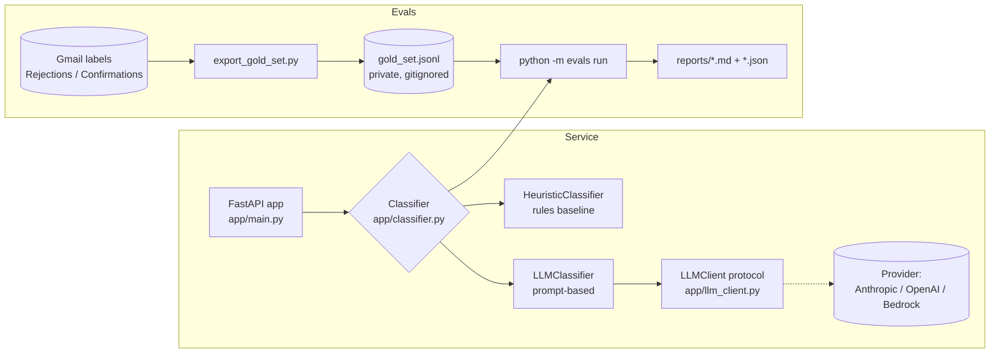

# Reply Classifier

A small FastAPI service that classifies job-application emails —
**rejection / confirmation / interview / other** — and extracts the company
and role, together with a labeled eval harness built on real data.

Why it exists: it plugs into a daily job-search reply check (same
classification job, automated), and it's a portfolio artifact demonstrating
production-style Python: a FastAPI service, Pydantic schemas, and — the part
AI postings actually mean by "evals" — a labeled gold set with
precision/recall reporting that any classifier change must beat.

## Architecture



Key design choices:

- **Provider-agnostic LLM access.** The classifier depends only on the
  `LLMClient` protocol (`complete(prompt) -> str`). Swapping providers is a
  one-class change in `app/llm_client.py`. Until a real client is wired in, a
  stub raises a clear error — the service never silently returns junk.
- **A baseline that runs with no API key.** `HeuristicClassifier`
  (keyword/rule scoring + regex extraction) makes the service and the eval
  harness work end-to-end out of the box. Its scores are the number the LLM
  prompt has to beat.
- **One schema everywhere.** Pydantic models in `app/models.py` define the
  email and the classification for the API, the classifiers, and the evals.

## Run the service

```bash
python3 -m venv .venv && source .venv/bin/activate
pip install -r requirements.txt

uvicorn app.main:app --reload          # http://127.0.0.1:8000
curl http://127.0.0.1:8000/health
curl -X POST http://127.0.0.1:8000/classify -H 'Content-Type: application/json' \
  -d '{"subject": "Thank you for applying to Future", "from": "no-reply@us.greenhouse-mail.io",
       "body": "Thank you for applying to Future. Your application has been received."}'
# -> {"class": "confirmation", "company": "Future", "role": null, "confidence": 0.95}
```

Endpoints: `GET /health`, `POST /classify` (one email), `POST /classify/batch`
(`{"emails": [...]}`). The active classifier is the `CLASSIFIER` env var
(`heuristic` default, `llm` once a provider exists) — see `.env.example`.

## Run the evals

```bash
# 1. Export the gold set from Gmail labels (requires the Gmail connector):
python evals/export_gold_set.py        # -> evals/data/gold_set.jsonl

# 2. Score a classifier against it:
python -m evals run                    # heuristic baseline
python -m evals run --classifier llm   # after wiring a provider
```

The harness prints and saves (under `reports/`) a report with overall
accuracy, per-class precision/recall/F1, a confusion matrix, and extraction
accuracy where gold records are annotated. PASS bar: accuracy >= 90% and
recall >= 80% for every class with support >= 5.

**Current baseline (heuristic, real gold set of 147 emails — 29 rejections,
118 confirmations): accuracy 95.9%; rejection P 1.000 / R 0.931 / F1 0.964;
confirmation P 0.991 / R 0.966 / F1 0.979.** Strong for a rules baseline —
ATS emails are well-separated — which sets a real bar for the LLM prompt.
Known gaps: the gold set has **zero `interview` examples** so far (none of the
labeled mail is an interview invite — the `Job Applications/Accepted` label is
the natural source when one arrives), and company/role extraction is not yet
scored (the export doesn't annotate them; hand-label a subset to unlock that
metric — the runner already supports it, see `evals/data/fixture_tiny.jsonl`).

## Privacy

`evals/data/gold_set.jsonl` is Jonathan's own email, exported for this local
project only. It is **gitignored — never commit, upload, or share it.** The
same applies to generated reports under `reports/` if they quote email text.

## Tests

```bash
python -m pytest        # 6 smoke tests: health, classify, batch, eval runner
```

## Weekend milestone checklist

From the build spec (packet §5 follow-up):

- [x] **Sat AM — service skeleton.** FastAPI app, `/classify` + `/classify/batch`
      + `/health`, provider-agnostic LLM client interface, heuristic baseline
      so it runs with no API key. *(scaffolded)*
- [x] **Sat PM — eval harness.** Gold-set export from the Gmail sublabels
      (147 real emails), `python -m evals run` with per-class
      precision/recall/F1, confusion matrix, JSON + Markdown reports.
      *(scaffolded; baseline scores above)*
- [ ] **Sat PM — wire a real LLM provider.** Implement an `LLMClient`
      (cheapest model first) in `app/llm_client.py`, set `CLASSIFIER=llm`.
- [ ] **Sat PM — prompt iteration.** Iterate `PROMPT_TEMPLATE` in
      `app/classifier.py` until the LLM beats the heuristic baseline
      (95.9% accuracy) on the full gold set. Inspect the confusion cases.
- [ ] **Gold-set growth.** Add `interview` examples when they exist, and
      hand-annotate company/role on a subset to enable extraction scoring.
- [ ] **Sun — ship it.** Public GitHub repo, this README + the eval results
      table, deploy (Fly.io / Railway free tier). Stretch: swap the LLM call
      to AWS Bedrock on deploy.

## Layout

```
app/            FastAPI service (main, models, classifier, llm_client)
evals/          eval harness (__main__ CLI, runner, export_gold_set)
evals/data/     gold_set.jsonl (private, generated) + fixture_tiny.jsonl (tests)
tests/          pytest smoke tests
reports/        generated eval reports (gitignored)
```
